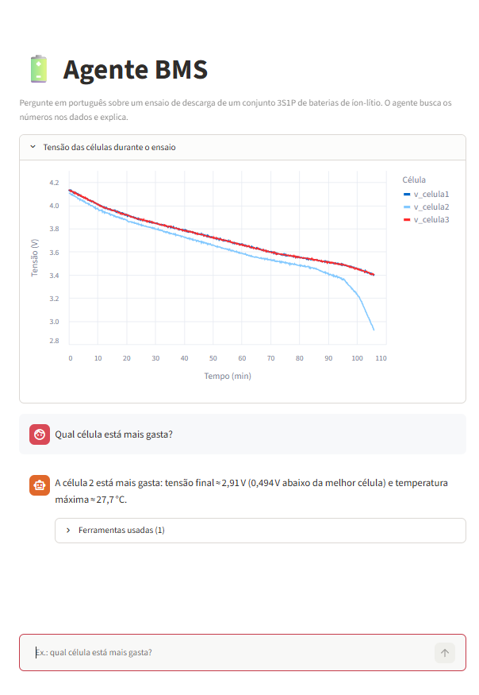
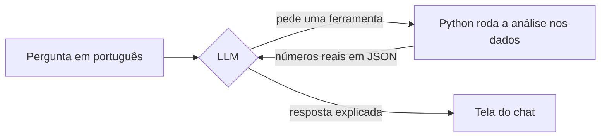

# 🔋 Agente BMS

**Pergunte em português sobre os dados de uma bateria e receba a resposta com os números reais.**

Um agente de IA que analisa ensaios de descarga de um conjunto de baterias de íon-lítio (3S1P). Ele entende a pergunta, escolhe qual análise rodar em Python e explica o resultado, sem inventar valores.

[](https://agentebms.streamlit.app/)



## Por que eu fiz isso

Na minha iniciação científica (PIBIC/IFTM), construí um protótipo que monitora três células 18650 em série com ESP32, ADS1115, INA219 e sensores NTC. Ele mostra as tensões numa página web, em tempo real. Mas ver números passando na tela não responde as perguntas que importam: *alguma célula está ficando para trás? Teve algum problema no ensaio?*

Ao mesmo tempo, eu queria aprender na prática como funcionam agentes com LLM. Então juntei as duas coisas: um assistente que conversa sobre os dados da bateria como um colega de laboratório faria, mas que só fala o que os dados mostram.

## O que dá pra perguntar

- "Qual célula está mais gasta e como você sabe?"
- "Como estava a bateria aos 30 minutos?"
- "Teve algum problema durante o ensaio?"
- "Qual era a tensão final de cada célula?"

Embaixo de cada resposta dá pra abrir **"Ferramentas usadas"** e ver de onde veio cada número.

## Como funciona

A divisão de trabalho é simples: **o LLM cuida da linguagem e o Python cuida das contas.**



1. Você faz a pergunta.
2. O LLM lê a pergunta e a descrição de cada ferramenta, e escolhe qual usar.
3. O Python roda a ferramenta nos dados e devolve os números.
4. O LLM escreve a resposta usando esses números.

| Ferramenta | O que faz |
|---|---|
| `avaliar_celulas` | Junta tensão, temperatura e alertas de cada célula para avaliar o desgaste |
| `resumo_celulas` | Tensão inicial, final, mínima e média de cada célula, e temperatura máxima |
| `verificar_alertas` | Procura desbalanceamento, subtensão e sobretemperatura |
| `estado_no_tempo` | Mostra todas as medições em um minuto específico do ensaio |

### De onde vêm os dados

Os testes da primeira etapa da IC foram feitos sem carga, então ainda não tenho um histórico real de descarga. Para não ficar parado, escrevi um simulador com os parâmetros do protótipo (células Samsung ICR18650-26J de 2600 mAh). Ele modela:

- a tensão de cada célula: a tensão de circuito aberto (que depende da carga restante) menos a queda na resistência interna, `V = OCV(SoC) − I·R`;
- o estado de carga, contando a corrente que passou;
- a temperatura, por um balanço de energia: calor gerado (`I²R`) menos o calor perdido para o ar;
- uma célula mais gasta, com menos capacidade e mais resistência interna, para o agente ter o que encontrar.

O CSV tem as mesmas colunas da interface do protótipo. Trocar dado simulado por dado real é trocar só o arquivo.

## O que eu aprendi

**Sem ferramentas, o LLM inventa muitas coisas.** Antes de criar as ferramentas, perguntei "qual era a tensão da célula 2 no final do ensaio?". O modelo nunca tinha visto os dados e respondeu **2,70 V**, sem avisar que estava chutando. O valor real é **2,91 V**. Com as ferramentas ele acerta, porque o número vem do Python.

**O que precisa acontecer sempre vai no código, não no prompt.** Tentei fazer o agente considerar temperatura e alertas ao avaliar o desgaste só escrevendo isso nas instruções. Ele ignorou em todas as tentativas. A solução foi criar a `avaliar_celulas`, que já entrega todas as evidências juntas. A mesma coisa aconteceu quando ele afirmou que a célula 2 tinha "atingido o limite de descarga", sendo que 2,91 V é maior que o corte de 2,75 V. Em vez de pedir no prompt, o resultado da ferramenta agora traz `atingiu_tensao_corte: false` escrito.

**O conhecimento de engenharia fica nas descrições.** No começo, o agente dizia que o desbalanceamento era a *causa* do desgaste. É o contrário: uma célula gasta tem menos capacidade e mais resistência interna, por isso descarrega antes e esquenta mais. Explicar essa relação na descrição da ferramenta fez ele passar a responder na ordem certa.

**Nome de campo ambíguo vira resposta errada.** Um campo chamado `abaixo_da_melhor_v` não dizia se a diferença era da tensão final ou da média, e o agente apresentou a diferença final (0,494 V) como se fosse da média (que é 0,083 V). Renomeei para `final_abaixo_da_melhor_v`.

**A tensão esconde o problema até o final.** Aos 50 minutos a célula 2 já tinha bem menos carga que as outras, mas a diferença de tensão era de só 0,064 V. É o platô da curva de descarga: o alerta de desbalanceamento só aparece aos 88,6 min. Um BMS que olha só a tensão avisa tarde.

## Limitações e próximos passos

- **Os dados são simulados.** A curva de tensão é simplificada no final da descarga, então a célula 2 para em 2,91 V em vez de cair até o corte de 2,75 V. O modelo térmico considera só o calor `I²R`.
- **Alertas baseados só em tensão chegam tarde**, pelo motivo acima.
- **O app usa o plano gratuito do Groq**, então pode ficar sem responder se o limite de uso for atingido.

Na segunda etapa da IC vou adicionar o gerenciamento ao protótipo (proteção e balanceamento). Os próximos passos deste projeto acompanham isso:

- [ ] Registrar o histórico do ESP32 (pela serial ou no Firebase) e usar dados reais
- [ ] Calibrar a curva de tensão e o modelo térmico com ensaios com carga
- [ ] Estimar o estado de carga de cada célula pela corrente, para detectar o desbalanceamento antes do fim do platô

## Estrutura

```
agente_bms/
├── app.py               # interface de chat (Streamlit)
├── agente.py            # laço entre o LLM e as ferramentas
├── ferramentas.py       # análises em Python (as ferramentas do agente)
├── dados.py             # de onde vêm os dados (hoje, o CSV simulado)
├── simulador.py         # gera o ensaio de descarga simulado
├── config.py            # parâmetros do protótipo, limites e modelo do LLM
├── dados_simulados.csv
├── teste_llm.py         # primeiro teste de conexão com o LLM
└── listar_modelos.py    # lista os modelos disponíveis na conta do Groq
```

## Rodando na sua máquina

Você vai precisar do Python 3.13 e de uma chave gratuita do [Groq](https://console.groq.com/keys).

```bash
git clone https://github.com/joaohenri21/agente_bms.git
cd agente_bms
python -m venv .venv
.venv\Scripts\activate          # no Linux/Mac: source .venv/bin/activate
pip install -r requirements.txt
```

Crie um arquivo `.env` na pasta do projeto com a sua chave:

```
GROQ_API_KEY=sua_chave_aqui
```

Depois é só escolher:

```bash
streamlit run app.py     # chat no navegador
python agente.py         # chat pelo terminal
python simulador.py      # gera um novo ensaio simulado
```

## Feito com

Python · pandas · NumPy · Groq (`gpt-oss-120b`) · Streamlit · Altair

## Autor

**João Henrique Rezende**, estudante de Engenharia da Computação no IFTM.

Se tiver alguma sugestão ou quiser conversar sobre o projeto, me chama no [LinkedIn](https://www.linkedin.com/in/joaohenriquerezende).
